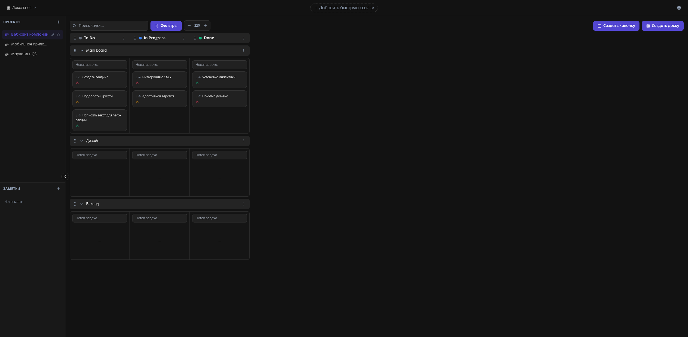
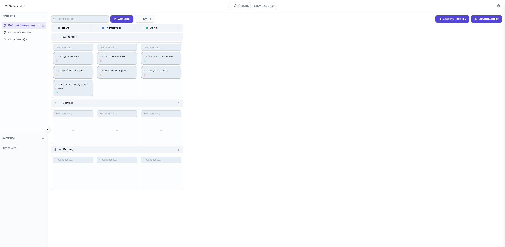
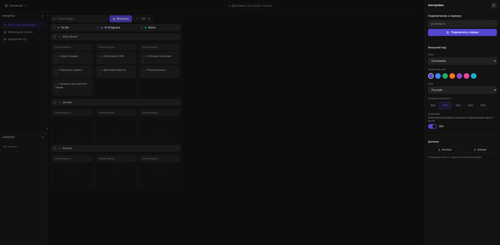

<p align="center">
  
</p>

<p align="center">
  <a href="https://github.com/quonaro/YourTab/actions/workflows/release.yml">
    
  </a>
  
  
  
</p>

# YourTab

Browser extension that replaces your new tab page with an agile board — kanban tasks, quick links, and notes. Works fully offline in local mode or synced with a self-hosted YourTask server.

## Screenshots

| Dark                                 | Light                                 |
| ------------------------------------ | ------------------------------------- |
|  |  |



## Features

- **Agile board in every new tab** — statuses as columns, boards as swimlanes, drag & drop between cells
- **Local & remote modes** — offline-first via IndexedDB, or connect to a YourTask server over REST + WebSocket live updates
- **OAuth sign-in (PKCE)** — secure `chrome.identity` auth flow, no stored passwords
- **Rich tasks** — priorities, deadlines, tags, sprints, assignees, recurring task indicators
- **Search, filters & sorting** — filter by status, priority, assignee, deadline
- **Projects sidebar, notes & quick links** — one new tab away from everything
- **Theming** — light / dark / system themes, 7 accent colors, UI scaling
- **Import / export** — back up and restore projects, tasks and settings as a file
- **English & Russian** — full localization
- **Chrome & Firefox** — MV3 and MV2 builds from a single codebase

## Install

### From a release zip

1. Download the latest `*-chrome.zip` or `*-firefox.zip` from [Releases](https://github.com/quonaro/YourTab/releases).
2. **Chrome:** unzip, open `chrome://extensions`, enable Developer mode, click **Load unpacked** and select the folder.
3. **Firefox:** open `about:debugging#/runtime/this-firefox` → **Load Temporary Add-on** → select `manifest.json` inside the unzipped folder.

### Connect to a YourTask server (optional)

Open **Settings → Server connection**, enter your server URL (e.g. `https://yourtask.app`) and click **Connect**. You'll be signed in via OAuth — boards then sync in real time. Without a server, everything works locally.

## Development

```bash
pnpm install

pnpm dev          # dev server with hot reload (Chrome)
pnpm dev:firefox  # dev server (Firefox)

pnpm build        # production build → .output/chrome-mv3
pnpm zip          # packed Chrome zip
pnpm zip:firefox  # packed Firefox zip

pnpm test         # vitest
pnpm typecheck    # vue-tsc
```

During development load `.output/chrome-mv3` (or `firefox-mv2`) as an unpacked extension. The dev server pre-renders the extension into `.output/` on every change.

## Tech stack

- **WXT + Vue 3 + TypeScript** — extension framework and UI
- **TailwindCSS** — styling
- **TipTap / marked** — notes and markdown rendering
- **IndexedDB** — offline storage for local mode
- **`chrome.identity` + PKCE** — OAuth against a YourTask server
- **WebSocket** — live board updates in remote mode
- **GitHub Actions** — builds, releases and AMO publishing via `web-ext sign`

## License

MIT
